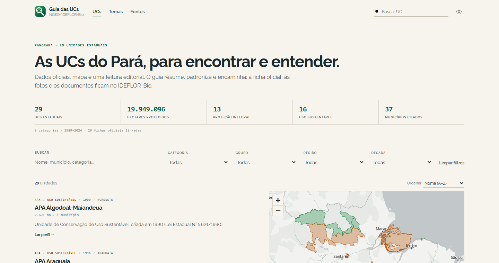
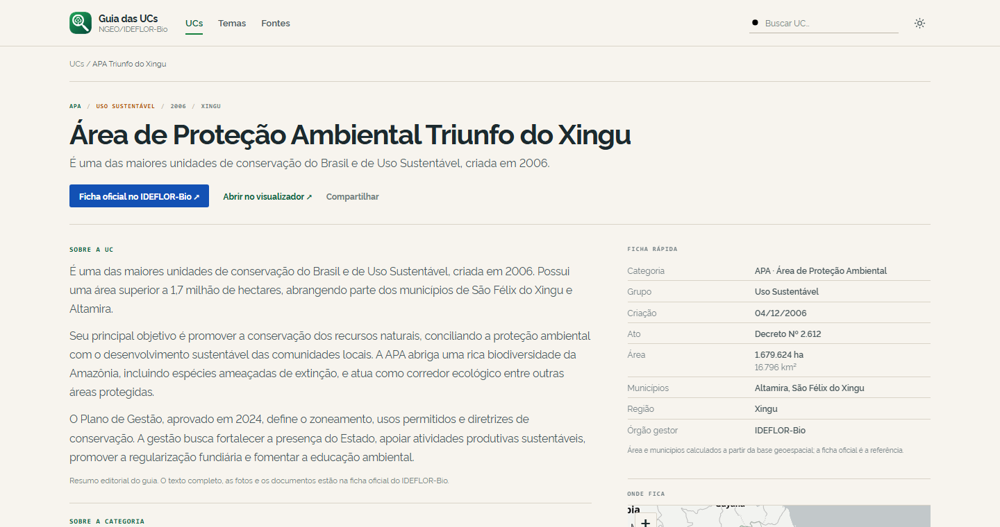

# Guia das UCs Estaduais do Pará — atlas editorial

**O site oficial é a fonte. O visualizador é a análise. O guia é a leitura e a descoberta.**

O Guia das UCs é uma ferramenta do **NGEO** (Núcleo de Geoinformação) do **IDEFLOR-Bio**, disponibilizada ao público. Ele ajuda a encontrar, entender e chegar à ficha oficial das 29 unidades de conservação estaduais do Pará — sem duplicar o site institucional nem refazer a análise espacial do Visualizador Geoespacial.

**Acesse:** [https://ngeo-ideflor-bio.github.io/guia-uc-para/](https://ngeo-ideflor-bio.github.io/guia-uc-para/)

---

## O que é (e o que não é)

- **É** um atlas de consulta: busca, filtros, mapa de localização, perfis padronizados, contexto editorial e links para a fonte oficial.
- **Não é** uma cópia do site do IDEFLOR-Bio. Cada perfil resume, padroniza e encaminha; fotos, decretos, plano de gestão, conselho e contato ficam na página oficial.
- **Não é** um substituto do Visualizador. O visualizador mostra limites, sobreposições e dados; o guia explica e encaminha.
- **Não é** um scrollytelling. A entrada do produto é a lista de consulta, com filtros e mapa.

### Os três papéis

| Onde | Responde |
|---|---|
| **Site oficial** | Onde estão os documentos, fotos, decretos e contatos? |
| **Visualizador** | Onde fica, qual o limite, o que se sobrepõe? |
| **Guia** | O que é, por que existe, o que protege e como chegar à fonte? |

---

## Funcionalidades

- **Home de consulta**: busca por nome, município, categoria, região ou resumo; filtros por categoria, grupo, região administrativa e década; ordenação por nome, ano e área. Cada filtro fica na URL.
- **Mapa do sistema**: as 29 UCs em um mapa Leaflet sobre um mapa base vetorial OpenFreeMap (MapLibre GL), coloridas por grupo (proteção integral / uso sustentável), com tooltip e clique para abrir o perfil. No celular, o mapa é colapsável e o mapa base só carrega quando é aberto.
- **29 perfis com URL própria**: `/uc/<slug>/`, com resumo editorial, ficha rápida, mapa locator, ficha técnica completa, fonte oficial e visualizador.
- **Fonte oficial em destaque**: cada perfil tem o botão **Ficha oficial no IDEFLOR-Bio** e um bloco de fonte; o guia não copia o texto oficial.
- **UCs relacionadas**: mesma categoria, grupo, região, década ou município.
- **Temas**: categorias de UC, evolução do sistema por década e uma ponte para a análise de territórios tradicionais no visualizador.
- **Fontes e dados**: metodologia, limites dos dados, links para as bases e para o projeto.
- **Tema claro/escuro** (claro por padrão) e **responsivo**, sem overflow horizontal.
- **Acessibilidade**: skip link, foco visível, contraste, `prefers-reduced-motion`, link/texto alternativo ao mapa.
- **Sem card soup**: conteúdo em listas editoriais com fios finos; bordas só em controles e no mapa.

---

## Capturas





---

## Números e desempenho

- 29 UCs, **19.949.096 ha**, 13 de proteção integral, 16 de uso sustentável, 8 categorias, **37 municípios citados** na base.
- `assets/data/ucs.json`: ~95 KB com fichas, estatísticas e relações.
- `assets/data/atlas.geojson`: ~229 KB (5% da geometria original) para o mapa.
- `assets/data/estado-simplificado.geojson`: ~20 KB.
- A lista inicial fica em torno de **570 KB** no celular (fontes, CSS, JS e `ucs.json`). O mapa base vetorial (MapLibre + OpenFreeMap) e as geometrias entram sob demanda: cerca de **1,4 MB adicionais** quando o mapa é aberto.
- Sem chave de API, sem Tailwind em runtime e sem CDN de bibliotecas: Leaflet, MapLibre, Rawline e os dados são locais.
- Os polígonos completos continuam em `assets/data/unidades_estaduais_para.geojson`; o mapa usa uma versão simplificada.

---

## Estrutura

```text
index.html                    home (shell + app JS)
uc/<slug>/index.html          29 perfis gerados (URL própria)
temas.html                    leitura do sistema
fontes.html                   fontes, metodologia e limites
assets/
  css/atlas.css               design editorial (Rawline, light-first)
  js/atlas.js                 home, perfis, temas, fontes, mapas
  data/
    ucs.json                  fichas normalizadas + estatísticas
    atlas.geojson             UCs simplificadas para o mapa
    estado-simplificado.geojson
    unidades_estaduais_para.geojson   fonte completa das UCs
    unidades_conservacao_resumo_conciso.csv  resumos e links oficiais
    estado.geojson            fonte do contorno estadual
  fonts/rawline/              Rawline 400/600/700 local
  vendor/leaflet/             Leaflet 1.9.4 local
  vendor/maplibre/            MapLibre GL JS local (mapa base)
  vendor/maplibre-gl-leaflet/ ponte MapLibre ↔ Leaflet
  img/brand-mark.svg          marca NGEO
scripts/
  build-atlas.mjs             normaliza dados, simplifica GeoJSON e gera perfis
sitemap.xml                   32 URLs
```

---

## Rodando localmente

O app precisa de HTTP (módulos ES, `fetch` e o mapa):

```bash
python -m http.server 8765
# abra http://localhost:8765/
```

Também funciona com qualquer servidor estático. Não abra via `file://`.

---

## Regerando dados e perfis

Pré-requisitos: Node.js 18+ e `npx mapshaper` (o primeiro uso baixa o pacote).

```bash
node scripts/build-atlas.mjs
```

O script:

1. lê o CSV e o GeoJSON das UCs;
2. normaliza municípios, região administrativa, resumo, links e fatos;
3. calcula estatísticas, categorias, décadas e UCs relacionadas;
4. grava `assets/data/ucs.json`;
5. simplifica o GeoJSON das UCs (5%) com mapshaper e gera `atlas.geojson` e `estado-simplificado.geojson`;
6. gera as 29 páginas em `uc/<slug>/index.html` e o `sitemap.xml`.

Para adicionar ou corrigir uma UC, edite `scripts/build-atlas.mjs`:

- `SHORT_NAMES` — nome curto e slug;
- `REGIOES` — região administrativa;
- `LINK_OVERRIDES` — links oficiais que precisam de correção;
- `SUMMARY_OVERRIDES` — resumos que precisam de curadoria;
- `MUNICIPIO_FIX` — correções de grafia dos municípios.

O CSV e o GeoJSON precisam ter a mesma lista de 29 nomes. O script falha se algum nome não casar.

---

## Dados e limites

- **Fonte oficial:** as páginas de cada UC no [IDEFLOR-Bio](https://ideflorbio.pa.gov.br/nossas-unidades/). O guia linka para elas.
- **Resumo:** leitura editorial baseada no `ResumoBreve` do CSV; não substitui o texto oficial.
- **Área:** calculada a partir da geometria da base geoespacial; pode variar em relação ao decreto ou à ficha oficial. Consulte a fonte oficial para o valor jurídico.
- **Municípios:** lista da base geoespacial; algumas fichas oficiais trazem listas mais completas.
- **Mapa:** polígonos simplificados para navegação; para limites detalhados, use o Visualizador.
- **Mapa base:** OpenFreeMap (estilos Positron e Dark), com dados do OpenStreetMap e do OpenMapTiles. São tiles vetoriais públicos, sem chave de API, com atribuição no mapa.
- **37 municípios citados** é a contagem após correção de grafias duplicadas na base (a contagem bruta anterior era 43). O número representa os municípios presentes nos dados, não necessariamente a lista oficial completa de cada UC.

---

## Tecnologias

- **Leaflet 1.9.4** local, com Canvas (`preferCanvas`), para as camadas e interações.
- **MapLibre GL JS 5 + OpenFreeMap** para o mapa base vetorial (Positron no tema claro, Dark no escuro), carregado sob demanda e sem chave de API.
- **HTML/CSS/JS** sem framework e sem build step para o app.
- **Rawline** local (400/600/700), sem Google Fonts.
- **Mapshaper** no pipeline de dados (simplificação a 5%).
- **Node.js** apenas para gerar dados e páginas.

---

## Versão anterior

O scrollytelling anterior foi retirado do site público. Ele permanece no histórico do Git e não é mais a entrada do produto; a home de consulta é a entrada atual.

---

## Licença

Código sob licença MIT. Textos, dados oficiais, marcas e imagens institucionais pertencem ao **IDEFLOR-Bio / Governo do Estado do Pará**.

Desenvolvido pelo **NGEO / IDEFLOR-Bio**.
